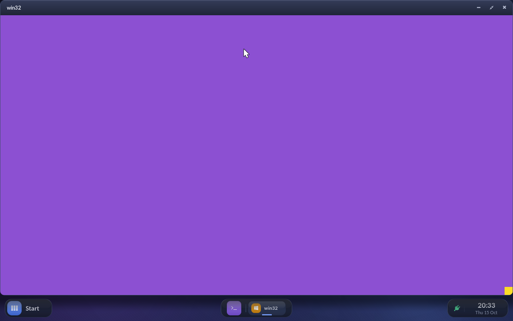
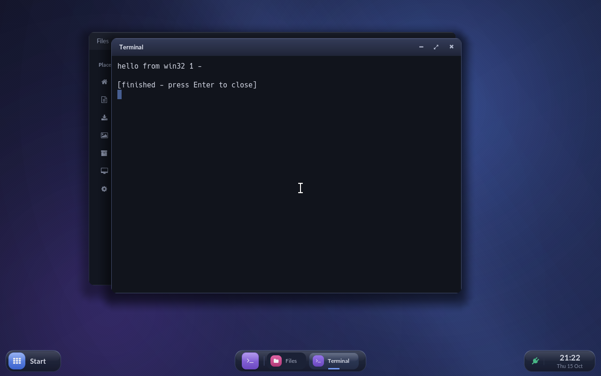
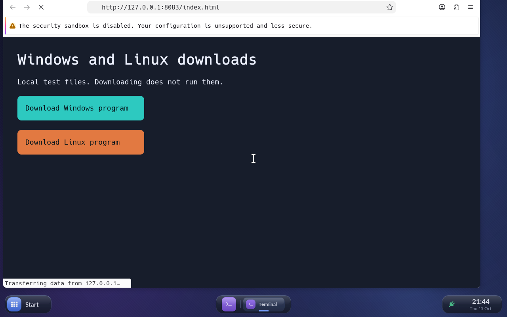
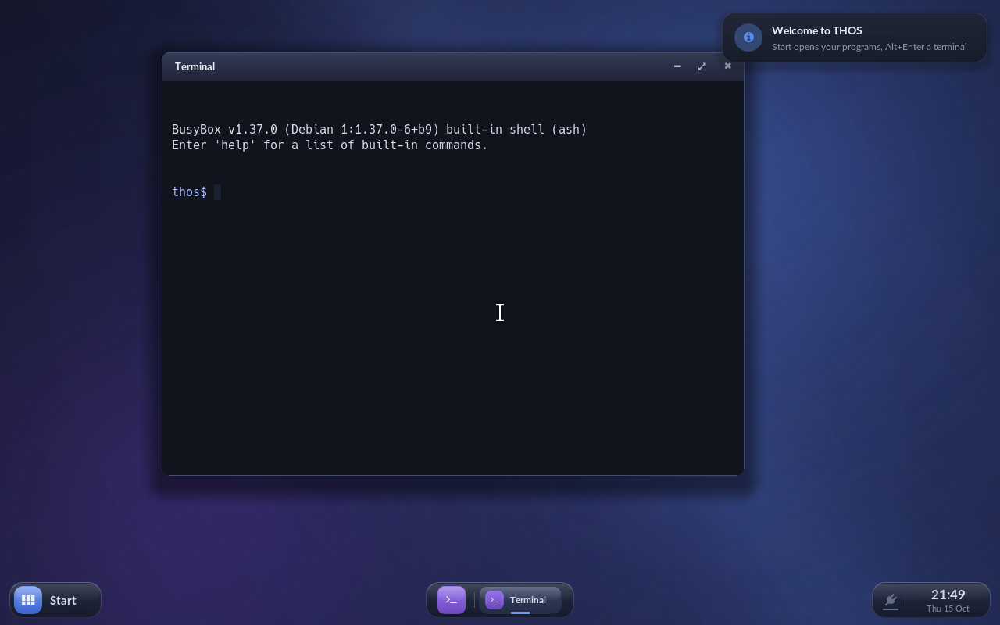

# THOS – bisheriger Abendstand vom 15. Oktober 2026

Layout, Controlbar, Animationen und Effekte sind erhalten. Die echte ASUS-Tastatur
wurde nicht verändert oder an QEMU durchgereicht. Kein USB-Stick wurde beschrieben.

- Windows-Fenster: Mausbewegung und drei Tasten, Alt-F4, Größenänderung,
  Maximieren, Vollbild und Wiederherstellen geprüft. Fenstertitel aktualisieren
  Titelleiste und Controlbar. Auch sechs native Apps bestehen die Größenprüfung.
- Downloads öffnen: Files startet echte x64-Windows- und Linux-Dateien über
  einen geprüften Starter. Leerzeichen, Apostroph und Dollarzeichen im Namen
  bleiben korrekt. Windows-CRT-Argumente und Ausführungsrechte wurden repariert.
  Echter Ripgrep unter Windows und Busybox unter Linux bestehen die Gasttests.
- ASUS hat jetzt Testpriorität. Der originale kleine Installer wurde mit dem
  veröffentlichten ASUS-Hash geprüft und nur im abgeschotteten Gast gestartet.
  Die erste fehlende Dateisuchfunktion ist ergänzt und geprüft. Weitere
  Windows-APIs und ganze Systembibliotheken fehlen; Aura Creator läuft noch nicht.
- Leichtes Windows-Spiel: originales SkiFree 1.04 geprüft. Es ist 32 Bit und wird
  vor dem Start abgelehnt. Der THOS-Windows-Lader unterstützt bisher x64.
- Firefox kann die lokale Download-Testseite tatsächlich darstellen. Nach dem
  Windows-Downloadklick stürzen jedoch Gastprozesse ab, auch mit 4 GiB RAM.
  Der Download mit anschließendem Start ist deshalb noch nicht bestanden.
  Firefox bleibt eine isolierte Diagnose mit deaktivierter Sandbox.

[ASUS-Prüfbericht](asus-compatibility-2026-10-15.md),
[ausführlicher Arbeitsbericht](worklog-2026-10-15-evening.md),
[aktuelle Fortsetzung](resume-2026-10-15.md).

Das endgültige lokale Live-Abbild wurde geprüft und übernommen. SHA-256:
`5f6096fdac54081bcbea65a8e5f4c310f4ec265ddcc88ed41d4d37ebef75cd44`.
Der vorherige Stand bleibt als `target/thos-live-pre-night-2026-10-15.img` erhalten.
Ein physischer Datenträger wurde nicht aktualisiert.

Hardwarebeschleunigung,
WLAN-Verbindung am Acer und vollständige Windows-/Linux-Anwendungskompatibilität
sind weiterhin größere offene Arbeiten. Die automatische Fortsetzung nach dem
Kontingent-Reset bleibt eingerichtet; neue Nutzerpausen haben Vorrang.

Spätere Diagnose: Der frühere Browser-Harness konnte Links nach einer
nachträglich eingeblendeten Firefox-Leiste verfehlen. Der tatsächliche
Downloadklick war damit noch nicht zuverlässig belegt; neue Prüfung verlangt
eine DOM-Klickbestätigung. Die Gastabstürze wurden protokolliert, ihr ursächlicher
Zusammenhang mit dem Download bleibt offen. Siehe Arbeitsbericht16.Oktober.
